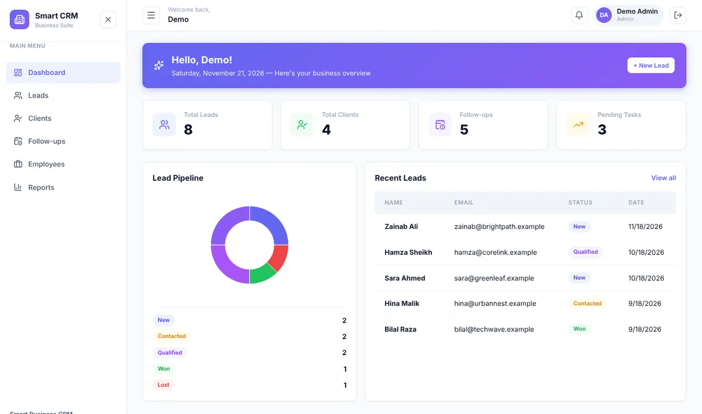
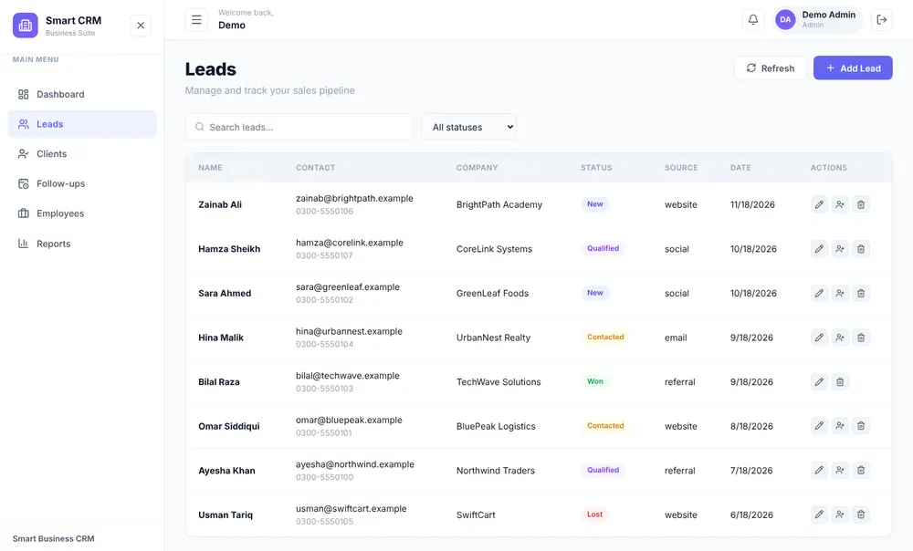
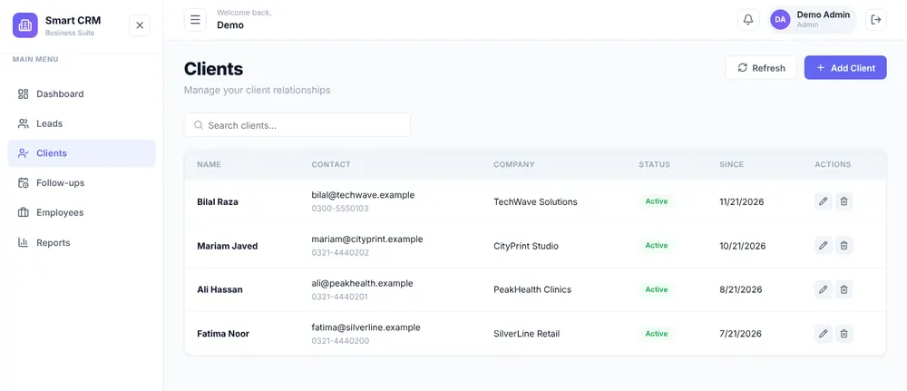
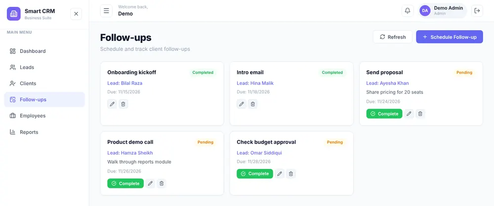
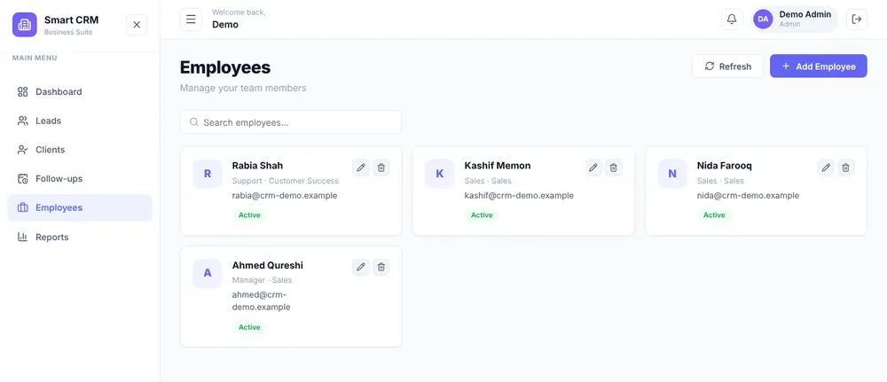
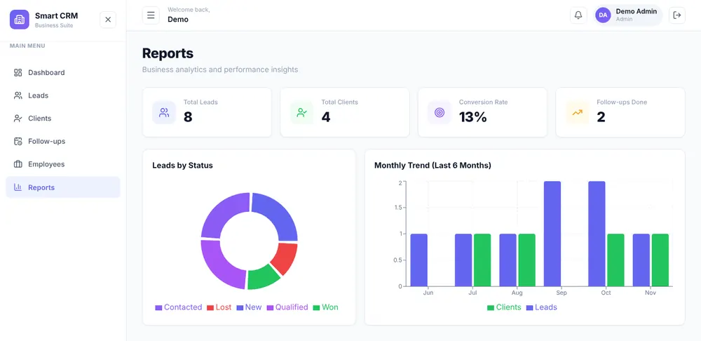
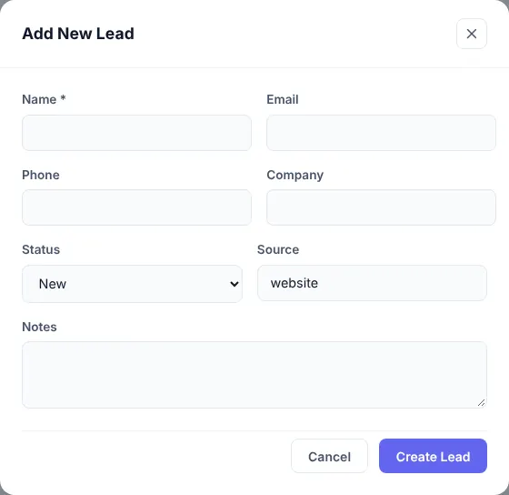
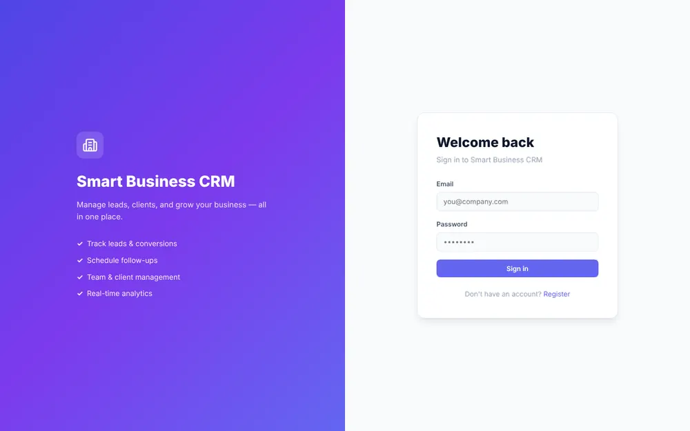
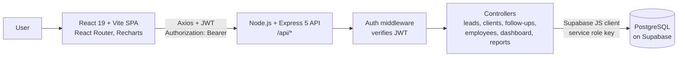
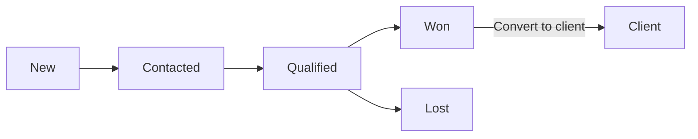

# Smart Business CRM

**A full-stack CRM for small businesses: track leads through a sales pipeline, convert them into clients, schedule follow-ups, manage your team and see sales reports, all in one dashboard.**




## Overview

Small businesses often track customers in spreadsheets, notebooks and chat threads. Leads get forgotten, follow-ups are missed, and nobody can say how many inquiries actually turned into customers.

**Smart Business CRM** gives a small team one place to manage the whole sales process: capture a lead, move it through the pipeline (**New → Contacted → Qualified → Won / Lost**), convert won leads into clients with one click, schedule follow-up tasks, and review conversion reports.

It is a React single-page app talking to a Node.js / Express REST API, with data stored in PostgreSQL on Supabase. Every account sees only its own records.

## Screenshots

| Leads pipeline | Clients |
|---|---|
|  |  |

| Follow-ups | Employees |
|---|---|
|  |  |

| Reports | Add a lead |
|---|---|
|  |  |

<details>
<summary><b>Login page</b></summary>



</details>

> Screenshots show the app running locally with fictional sample data.

## Problem and solution

| Problem | How Smart Business CRM solves it |
|---|---|
| Leads are scattered across spreadsheets and messages | One leads table with search, status filter, company, source and notes |
| It is unclear where each deal stands | Every lead has a pipeline status, shown as a colour badge and a pipeline chart |
| Follow-ups are forgotten | Follow-up tasks with due dates, linked to a lead, marked complete with one click |
| Won deals are re-typed into a customer list | **Convert to client** copies a lead's details into Clients and marks the lead as Won |
| No view of sales performance | Reports with conversion rate, leads by status and a six-month leads vs. clients trend |

## Features

| Module | What it does |
|---|---|
| **Dashboard** | Totals for leads, clients, follow-ups and pending tasks; lead pipeline donut chart; five most recent leads |
| **Leads** | Create, edit and delete leads; search; filter by status; convert a lead to a client |
| **Clients** | Create, edit, delete and search clients |
| **Follow-ups** | Schedule tasks with a due date and notes, link them to a lead, mark them complete |
| **Employees** | Team members with role (admin, sales, manager, support), department and active / inactive status |
| **Reports** | Conversion rate, completed follow-ups, leads-by-status chart and monthly leads vs. clients chart |
| **Authentication** | Register and log in; passwords hashed with bcrypt; JWT (7-day expiry) required on all data routes |

## Architecture



**Lead lifecycle**



1. The React app stores the JWT after login and sends it with every API request (Axios interceptor).
2. Express checks the token (`authMiddleware`) and loads the user.
3. Controllers read and write the user's own rows in Supabase PostgreSQL, filtered by `user_id`.
4. Dashboard and report numbers are calculated on the server from the user's leads, clients and follow-ups.

## Tech stack


| Layer | Technology |
|---|---|
| Frontend | React 19, Vite, React Router 7, Axios, Recharts, Framer Motion, Lucide icons, CSS |
| Backend | Node.js, Express 5, jsonwebtoken, bcryptjs, cors, dotenv |
| Database | PostgreSQL on Supabase (`@supabase/supabase-js`) |
| Dev tools | nodemon, ESLint |

## Project structure

```text
Smart-business-CRM/
├── backend/
│   ├── server.js            # Express entry point and route mounting
│   ├── config/              # Supabase client and connection check
│   ├── controllers/         # Auth, leads, clients, follow-ups, employees, dashboard, reports
│   ├── middleware/          # JWT auth and error handling
│   ├── routes/              # API route definitions
│   ├── utils/               # JWT helper
│   ├── supabase/            # SQL schema and fix-up migrations
│   └── .env.example
├── frontend/
│   ├── src/
│   │   ├── pages/           # Dashboard, Leads, Clients, FollowUps, Employees, Reports, Login, Register
│   │   ├── components/      # Sidebar, Navbar, Modal, StatusBadge, SearchInput, ...
│   │   ├── context/         # Auth and toast notifications
│   │   ├── layouts/         # Dashboard and auth layouts
│   │   ├── services/api.js  # Axios client with JWT interceptor
│   │   └── utils/           # Status labels, roles, chart colours
│   └── .env.example
└── docs/screenshots/        # README images
```

## Getting started

### Prerequisites

- [Node.js](https://nodejs.org/) 18 or higher and npm
- A [Supabase](https://supabase.com/) project (the free tier works)

### 1. Clone and install

```bash
git clone https://github.com/Bhavish295/Smart-business-CRM.git
cd Smart-business-CRM

cd backend && npm install
cd ../frontend && npm install
```

### 2. Set up the database

In the Supabase dashboard, open **SQL Editor** and run `backend/supabase/schema.sql`. It creates the `users`, `leads`, `clients`, `follow_ups` and `employees` tables.

If your tables already exist with different columns, run `backend/supabase/fix-all-tables.sql`.

### 3. Configure environment variables

Copy `backend/.env.example` to `backend/.env`:

| Variable | Description |
|---|---|
| `PORT` | API port (default `5000`) |
| `JWT_SECRET` | Secret used to sign login tokens. Use a long random value |
| `SUPABASE_URL` | Your project URL, e.g. `https://xxxx.supabase.co` |
| `SUPABASE_SERVICE_ROLE_KEY` | **Project Settings → API → service_role** key. Backend only, never commit it |
| `CLIENT_URL` | Frontend URL allowed by CORS (default `http://localhost:5173`) |

Copy `frontend/.env.example` to `frontend/.env`:

| Variable | Description |
|---|---|
| `VITE_API_URL` | Backend API base URL (default `http://localhost:5000/api`) |

### 4. Run locally

```bash
# Terminal 1: API on http://localhost:5000
cd backend
npm run dev

# Terminal 2: web app on http://localhost:5173
cd frontend
npm run dev
```

Open **http://localhost:5173**, register an account and start adding leads.

### Scripts

| Command | Location | Description |
|---|---|---|
| `npm run dev` | backend | Start the API with nodemon |
| `npm start` | backend | Start the API |
| `npm run dev` | frontend | Start the Vite dev server |
| `npm run build` | frontend | Production build |

## API endpoints

All routes except `register`, `login` and `health` need an `Authorization: Bearer <token>` header.

| Method | Endpoint | Description |
|---|---|---|
| `GET` | `/api/health` | Health check |
| `POST` | `/api/auth/register` | Create an account |
| `POST` | `/api/auth/login` | Log in and receive a JWT |
| `GET` | `/api/auth/me` | Current user |
| `GET` | `/api/dashboard/stats` | Dashboard totals, pipeline counts and recent leads |
| `GET` / `POST` | `/api/leads` | List / create leads |
| `PUT` / `DELETE` | `/api/leads/:id` | Update / delete a lead |
| `GET` / `POST` | `/api/clients` | List / create clients |
| `PUT` / `DELETE` | `/api/clients/:id` | Update / delete a client |
| `POST` | `/api/clients/convert/:leadId` | Convert a lead to a client and mark it Won |
| `GET` / `POST` | `/api/follow-ups` | List / create follow-ups |
| `PUT` / `DELETE` | `/api/follow-ups/:id` | Update / delete a follow-up |
| `GET` / `POST` | `/api/employees` | List / create employees |
| `PUT` / `DELETE` | `/api/employees/:id` | Update / delete an employee |
| `GET` | `/api/reports` | Report summary, leads by status and six-month trend |

## Troubleshooting

| Issue | Solution |
|---|---|
| `permission denied for table` | Run `backend/supabase/migration.sql` in Supabase |
| `column user_id does not exist` | Run `backend/supabase/fix-all-tables.sql` |
| Login fails | Check that the backend is running on port 5000 |
| CORS errors | Check `CLIENT_URL` in `backend/.env` |
| Empty dashboard | Add some leads first; data appears after creation |

## Security notes

- Never commit `.env` files or share the Supabase **service_role** key.
- Use the service_role key only in the backend, never in frontend code.
- Change `JWT_SECRET` before deploying.
- Rotate your Supabase keys if they are ever exposed.

## Future improvements

These are **not implemented yet**:

- Role-based permissions (employee roles are stored but do not limit access yet)
- Email or in-app reminders for due follow-ups
- Activity history per lead and client
- CSV import / export
- Automated tests and a hosted demo

## License

ISC

## Author

**Bhavish Kumar**: Full Stack Developer · AI Automation Engineer · Backend Developer

[GitHub](https://github.com/Bhavish295) · [LinkedIn](https://www.linkedin.com/in/bhavish-kumar-ab40a9303) · [Portfolio](https://bhavish-kumar-portfolio.netlify.app/)
